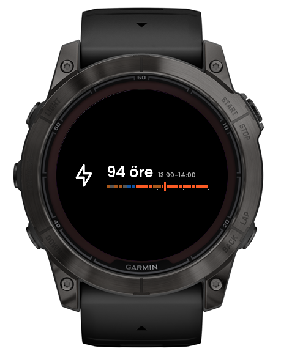
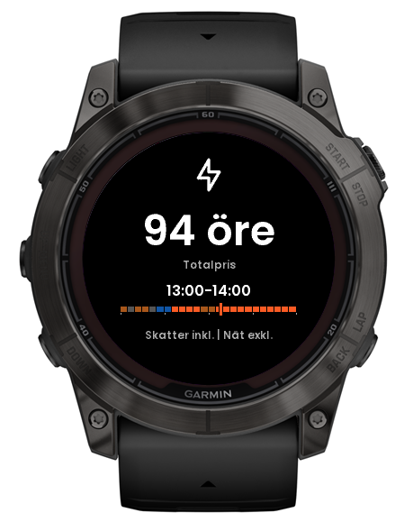
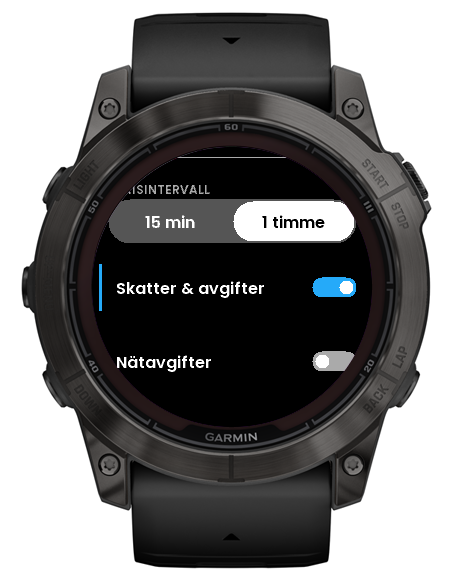
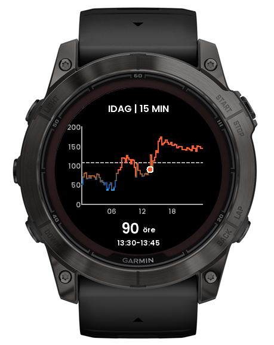
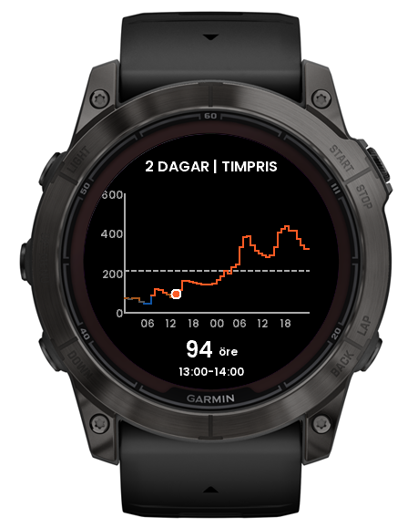

# Tibber Energy Widget for Connect IQ

A Garmin Connect IQ widget for displaying current Tibber electricity prices using the Tibber GraphQL API.

## Screenshots

### Main views

| Glance | Current price | Settings |
| :---: | :---: | :---: |
|  |  |  |

### Price charts

| Today's quarter-hour prices | Hourly prices for today and tomorrow |
| :---: | :---: |
|  |  |

Screenshots show the app in Swedish. Swedish (default), English, Norwegian Bokmål, German and Dutch are supported; the watch language selects the strings (`resources/strings` for Swedish, `resources-eng|nob|deu|dut/strings` for the others). Keep all files in sync when adding strings.

To try Norwegian, German or Dutch contracts without an account, use the built-in mock data: see [docs/mock-data.md](docs/mock-data.md).

Prices are shown in the minor unit of the currency Tibber returns: SEK as öre, NOK as øre, EUR as cent. The unit and the fee logic depend only on that API currency; the watch language only selects UI text (a Swedish contract on a German watch still shows öre). Grid fees and energy tax (Swedish tariff model) are only available for SEK; for NOK/EUR the widget shows Tibber's own spot or total price and labels it "as per Tibber" without adding fees.

## Controls

START/STOP refreshes prices, MENU opens settings, and BACK returns from graph or settings screens. From the main screen, UP opens the hourly graph and DOWN opens the quarter-hour graph. Within the graph, UP moves from hourly to quarter-hour prices and then back to the main screen; DOWN moves from quarter-hour to hourly prices and then back to the main screen. The hourly graph includes tomorrow's prices when they are available.

On older touch-only devices (vivoactive 4, venu), where a tap carries no position and vertical swipes exit the widget, a tap scrolls through the screens: main screen, quarter-hour graph, hourly graph, then back to the main screen. Tap no longer refreshes there; the price refreshes when the main screen is shown.

## Requirements

- Garmin Connect IQ SDK 9.3.0 or newer, with device packs for the selected target
- Garmin Monkey C VS Code extension (optional if using the SDK command line)
- A local Garmin developer signing key (`developer_key.der`) for compilation
- A Tibber API access token with permission to read home data

The application minimum API version is 3.2.0 for compatibility with retained older devices. Fenix 7 products have a higher device API baseline.

## Configure local credentials

Signing keys and local credentials are not stored in Git. Keep `developer_key.der` in `secrets/` as a local file; `.gitignore` excludes it.

Create a local secrets source from the template if one is not already present:

```sh
cp secrets/Secrets.mc.example secrets/Secrets.mc
```

Set your token as the return value of `TibberSecrets.getApiToken()` in `secrets/Secrets.mc`. That local file is ignored. Never put a real token in the template or commit it. The app sends authenticated HTTPS POST requests to Tibber and requests current price data when opened; refresh is available from the watch controls.

### Tibber token for users

Store users create a personal token at [developer.tibber.com](https://developer.tibber.com) and paste it into the app's **Tibber API token** setting in the Garmin Connect app (the watch shows "Enter Tibber token in app settings" until one is set). Changing the setting refreshes prices. The app uses the settings token first and falls back to the local `Secrets.mc` token described above, which is for development only.

### Store release build

`scripts/release.sh` builds the `.iq` from `monkey-release.jungle`, which swaps the local token class for the empty stub in `release/config/ReleaseSecrets.mc`, then checks that your local token is not in the package. `scripts/release.sh <device>` builds one `.prg` for a quick check. The full `.iq` needs every product in `manifest.xml` to be known to the installed SDK. For a complete release (version bump, changelog, tag), use `scripts/release-prepare.sh <version>`; see [docs/RELEASING.md](docs/RELEASING.md).

## Build

From the project root, compile a target with the installed SDK's Monkey C compiler:

```sh
monkeyc -f monkey.jungle -o /tmp/TibberWidget.prg -y secrets/developer_key.der -d fenix7xpro
```

Replace `fenix7xpro` with a supported product ID below. If `monkeyc` is not on `PATH`, invoke it by its full path under the installed SDK's `bin/` directory. The Garmin Monkey C extension can also build the project and launch it in the Connect IQ simulator. Keep build output outside the repository or in ignored generated-output directories.

## Run in the simulator

From the project root, compile for any product in `manifest.xml` and launch it in the simulator:

```sh
./monkeyInstall fenix7xpro
```

The script reads the supported products from `manifest.xml` on each run; run it without an argument to list them. It locates the SDK and Java, checks that the device pack is installed, writes `bin/TibberWidget-<device>.prg`, starts the simulator if it isn't running, and launches the package. `monkeydo` stays attached and streams the app's log output; press Ctrl+C to detach.

To build and run manually instead, start the simulator with `connectiq`, then run these commands from the project root. Removing the old package first ensures a failed compile cannot leave an older build to launch:

```sh
rm -f bin/TibberWidget-fenix7xpro.prg &&
monkeyc -f monkey.jungle -o bin/TibberWidget-fenix7xpro.prg -y secrets/developer_key.der -d fenix7xpro &&
test -s bin/TibberWidget-fenix7xpro.prg &&
stat -f 'Compiled: %Sm %N' bin/TibberWidget-fenix7xpro.prg &&
monkeydo bin/TibberWidget-fenix7xpro.prg fenix7xpro
```

If `connectiq`, `monkeyc`, or `monkeydo` is not on `PATH`, invoke the command from the installed SDK's `bin/` directory. Keep the simulator open while launching the package.

`./monkeyInstall <device>` compiles, launches, and also pushes the app's settings file (`bin/TibberWidget-<device>-settings.json`) with `monkeydo -a`, which the simulator's **Settings → App Settings Editor** needs; a plain `monkeydo` launch shows "No settings file found". Extra arguments are passed through to `monkeydo`. If the editor is empty after running the unit tests, use **File → Delete All Apps** and launch again: the tests install the same app id under a `-TESTS-` file name, which hides the settings of the normal build.

## Supported products

Devices are grouped into tiers by available memory, and support is rolled out from the newest, highest-memory devices backwards. See [docs/device-tiers.md](docs/device-tiers.md) for the tiers, test devices and current status.

- Approach: `approachs50`, `approachs7042mm`, `approachs7047mm`
- Descent: `descentg2`, `descentmk2`, `descentmk2s`, `descentmk343mm`, `descentmk351mm`
- Enduro: `enduro3`
- Epix: `epix2pro51mm`
- Fenix 5: `fenix5plus`, `fenix5splus`, `fenix5xplus`
- Fenix 6: `fenix6pro`, `fenix6spro`, `fenix6xpro`
- Fenix 7: `fenix7`, `fenix7pro`, `fenix7pronowifi`, `fenix7s`, `fenix7spro`, `fenix7x`, `fenix7xpro`, `fenix7xpronowifi`
- Fenix 8: `fenix843mm`, `fenix847mm`, `fenix8pro47mm`, `fenix8solar47mm`, `fenix8solar51mm`
- Fenix 9: `fenix943mm`, `fenix947mm`, `fenix9pro43mm`, `fenix9pro47mm`, `fenix9pro51mm`, `fenix9prosolar47mm`, `fenix9prosolar51mm`
- Fenix E: `fenixe`
- Forerunner 2xx: `fr245m`, `fr255`
- Forerunner 5xx: `fr57042mm`, `fr57047mm`
- Forerunner 6xx: `fr645m`
- Forerunner 7xx: `fr745`
- Forerunner 9xx: `fr945`, `fr945lte`, `fr955`, `fr965`, `fr970`
- Instinct: `instinct3amoled45mm`, `instinct3amoled50mm`, `instinctcrossoveramoled`
- Legacy (Marvel / Star Wars): `legacyherocaptainmarvel`, `legacyherofirstavenger`, `legacysagadarthvader`, `legacysagarey`
- Marq: `marqadventurer`, `marqathlete`, `marqaviator`, `marqcaptain`, `marqcommander`, `marqdriver`, `marqexpedition`, `marqgolfer`
- Other: `d2airx10`
- Venu: `venu`, `venu2`, `venu2plus`, `venu2s`, `venu441mm`, `venu445mm`, `venusq2`, `venusq2m`, `venusqm`, `venux1`
- Vivoactive: `vivoactive3m`, `vivoactive4`, `vivoactive4s`, `vivoactive5`, `vivoactive6`

Products are declared in `manifest.xml`. A device pack must be installed to compile or simulate a specific target.

## Price intervals

The main screen defaults to Tibber's `QUARTER_HOURLY` resolution. MENU opens settings; the first settings row switches between `QUARTER_HOURLY` and `HOURLY`. The graph pages use fixed resolutions: `QUARTER_HOURLY` for today, then `HOURLY` for today and tomorrow. If tomorrow's prices are not published yet, the second page shows today's hourly prices and an availability note. Both `getCurrentPrice(callback, resolution)` and `getDailyPrices(callback, resolution, includeTomorrow)` accept a resolution.

The graph plots Tibber's `today` series and appends `tomorrow` for its second page when available. Its compact interval data stores timestamp-based plot offsets and numeric price values, with resolution and currency kept once per series to limit memory use on smaller watches. A typical quarter-hour day contains 96 intervals, though daylight-saving transitions can change the count.

## Settings in the Garmin Connect app

Besides the Tibber token, the defaults can be changed from the phone (Garmin Connect, the app's settings): price type (total or spot), price interval (15 min or 1 hour), grid fees on or off, fixed grid fee (ore/kWh), variable grid fee (%), and energy tax (ore/kWh). Grid fees and energy tax apply to Swedish (SEK) contracts only; for other currencies they are ignored, and their titles say "Sweden only". Changes reach the watch the next time it syncs with the phone.

The phone and the watch's own settings screen share the same stored values, and the last change wins. A phone value is applied only when it differs from the phone value applied last time, so changing one setting on the phone does not overwrite a different choice made on the watch. To make the phone's value win again for a setting, change it on the phone. The settings are defined in `resources/settings/settings.xml` and `resources/properties.xml` (defaults must match `source/app/PhoneSettings.mc`).

## Energy tax and network fees

The energy-tax setting defaults to 45 ore/kWh including VAT, the Swedish standard rate for 2026. Its detail screen supports touch plus/minus controls and physical UP/DOWN buttons. Tax controls are available only when both taxes and network fees are enabled.

The network charge contains the fixed transfer fee, variable transfer fee, and configured energy tax. The enabled calculation is `final total = Tibber total + fixed transfer fee + variable transfer fee + configured energy tax`; no assumed tax amount is deducted. With network fees disabled, Tibber's total is unchanged regardless of the configured tax. This model treats the base price as excluding the configured grid energy tax. The app does not detect whether your home's API response already includes that tax; if it does, the configured addition can double-count it. Verify the response before comparing against a billed total. The default tax is not updated automatically for future tax years.

This calculation applies to total prices in the main widget, glance, and graphs. Spot-only prices are unchanged. Kraftringen's [transfer-fee example](https://www.kraftringen.se/privat/elnat/elnatsavgifter/var-prismodell-for-elnatsavgiften/overforingsavgift/) specifies 20 ore/kWh including VAT plus 5% of the hour's average spot price including VAT. The app adds 25% Swedish VAT to the raw spot-price basis once; it does not add VAT again to the fixed fee or configured energy tax. At 150 ore/kWh spot including VAT, transfer costs 27.50 ore/kWh; adding 45 ore energy tax gives a network charge of 72.50 ore/kWh, excluding monthly subscription fees.

The interval selector is the first settings row and is initially selected. Physical UP/DOWN navigation follows the displayed order, and every selected row remains centered.

## Pricing regression baseline

On 2026-10-25, this calculation was compared with the official Tibber app for one home and matched. This is a home-specific comparison, not a captured raw API response or a guarantee for every home. The regression cases preserve the full additive network charge, including configured energy tax; verify the API response and your own bill rather than assuming tax treatment is identical for every home.

The saved synthetic reference cases below use a base total of 200 ore/kWh, a fixed transfer fee of 20 ore/kWh including VAT, and a variable fee of 5%. Spot inputs exclude VAT; the calculator includes 25% VAT in the variable-fee basis. Expected totals are before display rounding.

| Hourly spot, excluding VAT | Configured energy tax, including VAT | Expected total, ore/kWh |
| --- | --- | --- |
| 120 | 45 | 272.50 |
| 0 | 45 | 265.00 |
| 120 | 33 | 260.50 |
| 120 | 0 | 227.50 |

`source/tests/NetworkFeeDetailTest.mc` saves these cases in `testConfirmedTibberPriceBaseline` alongside VAT, hourly averaging, cache, setting changes, and physical-button regressions. `source/tests/WidgetSettingsTest.mc` covers centering, interval-first navigation, toggle dependencies, and header hit-testing. Tests restore the settings and cache values they change and do not request live price data.

With the Connect IQ simulator running, build and execute all tests from the project root:

```sh
monkeyc -f monkey.jungle -o /tmp/TibberWidget-tests.prg -y secrets/developer_key.der -d fenix7xpro -t
monkeydo /tmp/TibberWidget-tests.prg fenix7xpro -t
```

To run only the pricing baseline:

```sh
monkeydo /tmp/TibberWidget-tests.prg fenix7xpro -t testConfirmedTibberPriceBaseline
```

## Typography

All app-drawn text uses bundled Poppins SemiBold bitmap fonts sized for watch displays, including Swedish characters and common symbols. The font is from Google Fonts and is distributed under the SIL Open Font License 1.1; see `resources/fonts/OFL.txt`. Rebuild the font resources after changing the source font with `python3 tools/build_poppins_price_font.py`.

The experimental Large profile is assigned in `monkey.jungle` and generated with `python3 tools/build_poppins_price_font.py --profile large`. Its resources override the standard fonts using the same resource IDs; only the selected font set is used for each build.

| Profile | Micro | Tiny | Small | Medium | Large | Price | Targets |
| --- | --- | --- | --- | --- | --- | --- | --- |
| Standard | 10 | 12 | 16 | 24 | 34 | 46 | All other targets |
| Large (experimental) | 14 | 16 | 22 | 32 | 46 | 62 | `fenix847mm` (fenix 8 / tactix 8 AMOLED) |

The Large profile needs visual validation on glance, price, chart, and settings screens before extending it to other devices. Remove the `fenix847mm.resourcePath` override to return that target to Standard.

Price charts reserve space for measured Y-axis labels and footer font heights. The current-price footer is centered below the X-axis labels with a bottom inset proportional to the screen size.

`source/charts/PriceChart.mc` separates price scaling, layout, interval projection, header, axes, step series, marker, and footer rendering. Chart-specific geometry and drawing constants are kept at the top of the class; shared colors remain in `Theme`. `source/tests/PriceChartTest.mc` covers layout baselines for both font profiles, axis ticks, series geometry, and footer positioning and font fallback.

## Project layout

- `source/app/App.mc`: application lifecycle and entry point
- `source/screens/`: current-price, glance, graph, settings, and network-fee detail views
- `source/delegates/`: input handlers for the widget, graph, settings, and fee-detail screens
- `source/network/`: Tibber GraphQL requests and price caching
- `source/charts/` and `source/components/`: graph renderer and reusable UI components
- `secrets/`: local (git-ignored) signing key and token class, plus the token-free template
- `source/theme/` and `source/tests/`: shared theme and simulator tests
- `source/settings/`: phone (Garmin Connect) settings sync
- `source/mock/`: development-only mock data (see `docs/mock-data.md`)
- `resources/`: application strings, bitmap assets, and bundled fonts
- `release/config/`: token-less stubs used by the store build (`monkey-release.jungle`)
- `scripts/`: build, test, check, and release tooling (`./monkeyInstall` in the root wraps `scripts/install.sh`)
- `docs/`: guides, release notes, feature ideas, and store assets

## Disclaimer

This is an independent, standalone Connect IQ app project. It is not affiliated with, endorsed by, sponsored by, or associated with Tibber AB, Garmin Ltd., or their affiliates. Tibber, Garmin, and Connect IQ are names and marks of their respective owners.

The app and its price calculations are provided "as is," without warranty. API data, rates, configured fees, and availability may be incomplete or change. Verify prices and fee assumptions with your provider before relying on them. Use the app at your own risk; you are responsible for securing your credentials and complying with applicable API terms and laws.

## Data and privacy

The access token is sent to Tibber's GraphQL endpoint over HTTPS. A token in the local secrets source is included in builds compiled from that source, so do not share a build containing your personal token. Use a personal access token only for your own account; a distributed app should use Tibber's OAuth flow rather than embedding a personal token. Follow Tibber's API terms and applicable privacy requirements.

## License

The project source is licensed under the MIT License; see `LICENSE`. The bundled Poppins font files are separately licensed under the SIL Open Font License 1.1; see `resources/fonts/OFL.txt`.